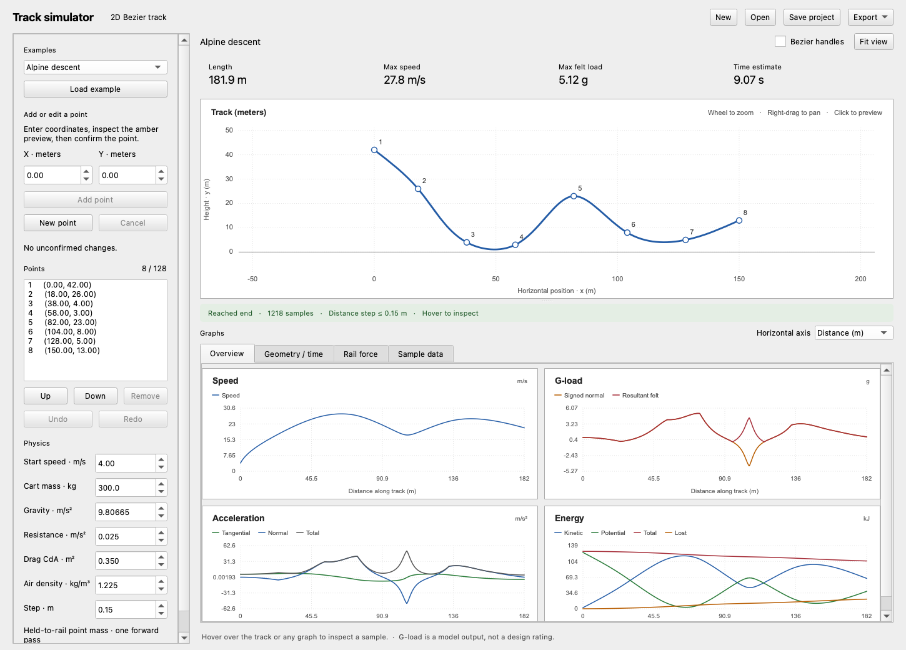

# RailLab

This personal project was kept locally on my computer before being uploaded to GitHub for submission. The commit history here starts with that upload.

A C++ program for making 2D roller-coaster tracks with Bezier curves and plotting the physics. No animation.



## Why I built this

In my computational science class, we did a group project on differential
equations. I wanted to try a project of my own as well, and roller coasters seemed
like the most fun thing to build a simulation around. I really enjoyed working
on it.

## Running it

You need CMake, a C++20 compiler and Qt 6.4+ (Widgets, SVG and Test). On macOS:

```bash
brew install cmake qt
./run.sh
```

`./run.sh --test` builds and runs the tests. `./run.sh --build-only` just builds it.

For a manual CMake build on macOS, use the selected Apple compiler and SDK:

```bash
cmake -S . -B build -DCMAKE_BUILD_TYPE=Release \
  -DCMAKE_CXX_COMPILER="$(xcrun --find clang++)" \
  -DCMAKE_OSX_SYSROOT="$(xcrun --sdk macosx --show-sdk-path)"
cmake --build build --config Release --parallel 4
ctest --test-dir build -C Release --output-on-failure
```

On Linux or Windows, omit the two Apple-specific arguments in the manual commands.
On Ubuntu 24.04, install `qt6-base-dev` and `libqt6svg6-dev` first. You may need to set `CMAKE_PREFIX_PATH` if Qt is installed somewhere CMake cannot find.

## Using it

Click New, enter X and Y, then click Add point. The orange point and dashed line are only a preview until you confirm. Add at least two points to get a track. Points are connected in list order.

Select a point to edit it. Apply point edit confirms the change; Cancel discards it. You can also remove points, move them up/down in the list, and undo changes. Wheel zooms and right-drag pans the track.

Choose the two endpoints under **Segment force** (for example, **Point 1 → Point 2**), enter a finite **Applied force (N)**, then click **Apply force**. Positive values provide propulsion, negative values provide braking opposite travel, and 0 disables the applied force. Each segment has its own value, initially 0 N. Selecting a point also selects its outgoing segment (the last point selects the last segment). Signed forces are saved in the project JSON and support Undo/Redo. The force follows the local tangent, including around curves; **Applied work** in the energy plot and **Applied work (J)** in Sample data show its accumulated signed work. The existing CSV columns `forward_force_N` and `propulsion_work_J` retain their names and now also represent negative force and braking work.

For example, on a flat track with no drag or resistance, a 100 kg cart entering at 2 m/s under **-100 N** stops after 2 m and receives **-200 J** of applied work. If that braking segment is only 1 m long, it removes 100 J and the cart enters an unpowered segment at about 1.414 m/s. Analysis remains forward-only: braking work ends at the stopping point and the cart never reverses.

Moving a point's coordinates preserves its segment forces. **Insert after selected point** previews a split; confirm with **Insert point**, and both halves inherit the original force. Removing an interior point merges its two segments using the incoming segment's force. New segments at either end start at 0 N; removing an endpoint removes only its adjacent force. Reordering points keeps forces on unchanged ordered endpoint pairs and sets new connections to 0 N. Unrelated segments retain their values.

The plots show speed, G-load, acceleration, energy, height, curvature, rail force, inclination and time. The horizontal axis can be distance or time. Hover over a plot to inspect a sample. Scroll the graph area if the window is small.

Save/Open uses JSON files. Export saves either CSV data or an SVG with all the plots. Only confirmed points are saved.

Projects now save as version 2 with a `segment_forces_N` array in point-list order. Version 1 projects without that array load with 0 N on every segment. Click **Apply force** before saving; unconfirmed force input is not saved. Older RailLab versions cannot open version 2 projects.

Three examples are included: a descent, a loop and a hill the cart cannot finish climbing. You can load them in the app or open the JSON files in `examples/`.

## The calculations

The points are interpolated with a natural cubic spline, stored as cubic Bezier segments. The physics uses arc length, gravity, quadratic drag, constant resistance and per-segment propulsion or braking. Applied work equals signed force times the distance actually traveled in its segment. The cart is a point mass held to the track. Analysis ends when it reaches the end or runs out of forward speed; an unreachable powered segment cannot restart it.

The model does not include a whole train, wheel contacts, free flight or rollback. Negative signed normal forces are allowed because the cart is held to the rails. Times and peak loads are numerical estimates.

The equations and numerical limits are explained in [physics.md](docs/physics.md). An exported example is in [example-report.svg](docs/example-report.svg).

The final-review regressions are stored unchanged in `tests/fixtures/final-check/`.
`./run.sh --test` also opens all six JSON tracks through the Qt window and checks
their stopping points, powered restart, strong-drag speed/time and very slow motion.
CSV exports include `time_resolution_limited`; the CLI labels unresolved travel
time explicitly. Time on general curved tracks remains a numerical estimate.

## Code

- `src/core/`: curves, arc length, physics and CSV files. No Qt dependency.
- `src/app/`: window, point editing, graphs and JSON files.
- `src/cli.cpp`: command-line version.
- `tests/`: analytical checks and UI tests.

To build just the core and command-line program:

```bash
cmake -S . -B build-core -DRAILLAB_BUILD_GUI=OFF \
  -DCMAKE_CXX_COMPILER="$(xcrun --find clang++)" \
  -DCMAKE_OSX_SYSROOT="$(xcrun --sdk macosx --show-sdk-path)"
cmake --build build-core --parallel 4
./build-core/rail_analyze examples/alpine.csv --output analysis.csv
```

The CLI returns 0 for a completed track, 2 for a stop or sample limit, and 1 for invalid input.
An output CSV may replace an existing report. It is rejected if it refers to the
input points file, including through a symbolic or hard link. This check prevents
ordinary accidental input replacement; it is not protection against concurrent
malicious filesystem changes. CLI exports write directly and may leave a partial
report after an I/O failure; project JSON saves use `QSaveFile`.

Tested locally on Apple Silicon macOS with Qt 6.11.1. The tests cover the math, stopping events, preview confirmation, undo, saving and exporting. A GitHub Actions workflow is included but has not been run remotely. Linux and Windows runtime behavior has not been checked locally.

## Configuration and verification

No credentials or network service is used at runtime. Physics parameters are
stored in example JSON projects or passed as CLI options; `rail_analyze --help`
lists the CLI options. CSV points use meters and a header such as `x,y`.
The documented `./run.sh --test` also passed without an SDK override.
The preparation review built the Qt desktop application and passed all three
CTest entries: core analytical checks, CLI regression checks, and offscreen UI
checks. A follow-up fresh build also passed the screenshot-enabled UI suite;
rendered overview, preview, loop, stalled-track, compact-window, and SVG report
artifacts were reviewed locally. These checks exercise the Qt widgets offscreen.
The November 4 follow-up also used the native macOS UI to create a two-point
track, check preview versus confirmed points, undo/redo, and save a JSON project.
The saved coordinates and settings were inspected. This is a limited native smoke
check; the automated suite supplies the broader export/edit coverage.
